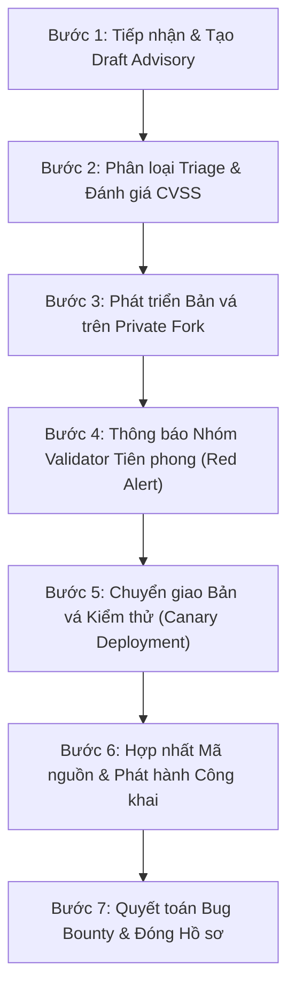

# 🛡️ CHÍNH SÁCH BẢO MẬT & QUY TRÌNH ỨNG PHÓ SỰ CỐ WIKIALISA
### *WIKIALISA SECURITY POLICY & INCIDENT RESPONSE PROTOCOL*
> **Tổ chức quản trị:** Wikialisa Foundation & Core Team  
> **Cơ sở kế thừa hợp pháp:** Kế thừa từ Solana SDK & Agave Security Framework (Apache-2.0 / MIT Attribution)  
> **Kho lưu trữ chính thức:** [`wikialisa/wikialisa-sdk`](https://github.com/wikialisa/wikialisa-sdk)  
> **Kênh tiếp nhận khẩn cấp:** `security@wikialisa.org` | **Thời gian phản hồi:** ≤ 48 - 72 giờ  

---

## 📑 MỤC LỤC CHI TIẾT (TABLE OF CONTENTS)

1. [Tuyên Bố Thừa Hưởng Hợp Pháp & Chủ Quyền Bảo Mật (Legal Attribution & Sovereignty)](#1-tuyên-bố-thừa-hưởng-hợp-pháp--chủ-quyền-bảo-mật)
2. [Quy Chuẩn Báo Cáo Lỗ Hổng Bảo Mật (Vulnerability Reporting Guidelines)](#2-quy-chuẩn-báo-cáo-lỗ-hổng-bảo-mật)
3. [Quy Trình 7 Bước Ứng Phó Sự Cố (7-Step Incident Response Protocol)](#3-quy-trình-7-bước-ứng-phó-sự-cố)
4. [Phân Cấp Mức Độ Nghiêm Trọng & Ma Trận Nguy Cơ (Severity Matrix)](#4-phân-cấp-mức-độ-nghiêm-trọng--ma-trận-nguy-cơ)
5. [Chương Trình Khen Thưởng Lỗ Hổng (Security Bug Bounty Program)](#5-chương-trình-khen-thưởng-lỗ-hổng)
6. [Quy Định Vệ Sinh An Toàn Kỹ Thuật (Maintainer Security Hygiene)](#6-quy-định-vệ-sinh-an-toàn-kỹ-thuật)

---

## 1. TUYÊN BỐ THỪA HƯỞNG HỢP PHÁP & CHỦ QUYỀN BẢO MẬT

Tài liệu này xác lập chính sách bảo mật chính thức cho hệ sinh thái **Wikialisa Layer 1**, bao gồm các crate `wikialisa-program`, `wikialisa-sdk`, `wikialisa-runtime` và `wikialisa-client`.

- **Thừa hưởng hợp pháp (Legal Open Source Heritage):** Wikialisa kế thừa và mở rộng khuôn khổ bảo mật của dự án `solana-sdk` và `agave` theo giấy phép **Apache License 2.0**. Mọi quyền tác giả ban đầu thuộc về Solana Foundation và Anza Maintainers được tôn trọng và ghi nhận đầy đủ.
- **Phân tách trách nhiệm & Độc lập thương hiệu:** Toàn bộ quy trình tiếp nhận, điều phối, vá lỗi và vận hành mạng lưới thử nghiệm (Testnet)/chính thức (Mainnet) của Wikialisa do **Wikialisa Core Team & Foundation** độc lập chịu trách nhiệm. Không có sự liên đới bảo mật trực tiếp nào tới các hệ thống validator gốc của Solana/Anza.

---

## 2. QUY CHUẨN BÁO CÁO LỖ HỔNG BẢO MẬT

> ⚠️ **CẢNH BÁO TỐI QUAN TRỌNG:**  
> **TUYỆT ĐỐI KHÔNG TẠO PUBLIC ISSUE TRÊN GITHUB** đối với các báo cáo lỗi bảo mật, nguy cơ tấn công từ chối dịch vụ (DoS), rò rỉ khóa ví, hoặc sai lệch trạng thái tài khoản. Mọi báo cáo công khai trước khi có bản vá sẽ bị hủy tư cách tham gia chương trình Bug Bounty.

### Kênh Báo Cáo Chuẩn (Official Reporting Channels):

1. **GitHub Private Security Advisory (Ưu tiên số 1):**  
   Gửi báo cáo trực tiếp thông qua liên kết bảo mật:  
   👉 **[Tạo Báo Cáo Lỗ Hổng Riêng Tư (Submit a Security Advisory)](https://github.com/wikialisa/wikialisa-sdk/security/advisories/new)**
   
2. **Email Khẩn Cấp Được Mã Hóa (Fallback Emergency Channel):**  
   Nếu không thể sử dụng giao diện GitHub, gửi thư điện tử tới:  
   📧 **`security@wikialisa.org`**  
   *(Chỉ gửi tiêu đề và tóm tắt cấp cao; chi tiết PoC khai thác phải được trao đổi qua kênh mã hóa PGP hoặc liên kết Advisory được cấp quyền).*

### Yêu Cầu Bắt Buộc Đối Với Báo Cáo:
- **Tiêu đề rõ ràng:** Nêu rõ module bị ảnh hưởng (ví dụ: `[Runtime] Xung đột khóa ghi trong Rayon Batch Processor`).
- **Mô tả kỹ thuật chi tiết:** Phân tích nguyên nhân gốc rễ (Root Cause Analysis).
- **Bằng chứng thực nghiệm (Proof-of-Concept - PoC):** Mã nguồn kiểm thử hoặc kịch bản tái hiện cụ thể. Các giả thuyết suy đoán thiếu PoC sẽ không được thụ lý.
- **Kích hoạt xác thực hai yếu tố (2FA):** Tài khoản GitHub của người báo cáo bắt buộc phải bật 2FA để bảo vệ chuỗi trao đổi.

---

## 3. QUY TRÌNH 7 BƯỚC ỨNG PHÓ SỰ CỐ (7-STEP INCIDENT RESPONSE PROTOCOL)

Khi một sự cố an ninh được phát hiện hoặc báo cáo, Đội phản ứng sự cố Wikialisa (Wikialisa Incident Response Team - SIRT) sẽ tuân thủ nghiêm ngặt quy trình 7 bước kế thừa và tăng cường:



### Bước 1: Tiếp Nhận & Khởi Tạo Dự Thảo (Accept the Report)
- Thành viên Ban Quản Trị Bảo Mật (`wikialisa/admins`) tiếp nhận báo cáo và chuyển thành **Draft Security Advisory**.
- Tạo một bản sao chép riêng tư (**Private Fork**) liên kết trực tiếp với Advisory để chuẩn bị không gian làm việc bí mật.
- Nếu là phát hiện từ kiểm toán độc lập, tiêu đề bắt đầu bằng tiền tố `[Audit]`.

### Bước 2: Phân Loại & Đánh Giá Mức Độ (Triage)
- Hội đồng Kỹ thuật thảo luận bảo mật trong Advisory để xác định tính hợp lệ và mức độ nghiêm trọng (Critical / High / Medium / Low).
- Bổ sung các kỹ sư chuyên trách vào Advisory để hỗ trợ bóc tách lỗi nếu cần thiết.
- Nếu vấn đề không ảnh hưởng an ninh mạng lưới, Advisory sẽ được đóng lại và chuyển thành Issue thảo luận thông thường.

### Bước 3: Phát Triển & Kiểm Định Bản Vá (Prepare Fixes)
- Kỹ sư phát triển bản sửa lỗi trực tiếp trên nhánh của Private Fork.
- **Quy tắc Build nghiêm ngặt:** Do Private Fork không chạy public CI, toàn bộ mã nguồn phải được biên dịch thủ công từ source, chạy kiểm thử tĩnh `cargo clippy`, quét tràn bộ nhớ, và chạy bộ test suite toàn diện (`cargo test --workspace`).
- Bản vá bắt buộc phải vượt qua bài đánh giá chéo (Peer Review) từ người báo cáo và tối thiểu 2 thành viên nòng cốt của Wikialisa Core Team.

### Bước 4: Kích Hoạt Hệ Thống Báo Động Đỏ Validator (Wikialisa Red Alert)
- Khi có thời gian dự kiến (ETA) hoàn thành bản vá, điều phối viên kích hoạt cơ chế **"Wikialisa Red Alert"** thông báo kín cho các cụm Validator chính.
- Cung cấp hướng dẫn hành động đúng thời điểm, đảm bảo các đội ngũ vận hành toàn cầu chuẩn bị sẵn sàng nâng cấp mà không làm gián đoạn tính sẵn sàng của mạng.

### Bước 5: Chuyển Giao Bản Vá Thử Nghiệm (Ship the Patch)
- Bản vá được đóng gói dạng binary hoặc patch diff mật mã gửi trực tiếp tới các node Validator kiểm thử nội bộ.
- Đo lường mức tiêu hao Compute Units (CU), thời gian hoàn tất khối và đảm bảo không gây phân kỳ chuỗi (Hard Fork ngoài ý muốn).

### Bước 6: Phát Hành Chính Thức & Công Bố Rộng Rãi (Public Release & Disclosure)
- Sau khi tỷ lệ Validator an toàn vượt ngưỡng bảo đảm (≥ 80% Stake), bản vá được hợp nhất từ Private Fork vào nhánh `master` và các nhánh bảo trì `maintenance/**`.
- Phát hành phiên bản chính thức mới (New Tag Release) trên GitHub và crates.io.
- Phát đi thông cáo nâng cấp khẩn cấp tới toàn bộ cộng đồng mạng lưới.

### Bước 7: Quyết Toán Bug Bounty & Tổng Kết Hậu Kiểm (Bounty Accounting & Cleanup)
- Xác lập danh mục khen thưởng chính thức và thống nhất mức chi trả với nhà nghiên cứu.
- Công bố báo cáo kiểm toán bảo mật tóm tắt (Post-Mortem / CVE) và đóng Advisory an toàn.

---

## 4. PHÂN CẤP MỨC ĐỘ NGHIÊM TRỌNG & MA TRẬN NGUY CƠ

Wikialisa phân loại rủi ro kỹ thuật thành 6 danh mục cốt lõi:

| Danh Mục Khen Thưởng | Bản Chất Nguy Cơ Kỹ Thuật | Phạm Vi Ảnh Hưởng | Mức Độ |
| :--- | :--- | :--- | :--- |
| **Loss of Funds** | Khai thác rút trộm lamports/token, giả mạo số dư trong `AccountsDb` hoặc bypass chữ ký. | Toàn bộ tài sản người dùng và quỹ dự trữ. | **Tối khẩn cấp (Critical)** |
| **Consensus / Safety Violations** | Lỗi phân kỳ khối, vi phạm trật tự đồng thuận PoH/PoK, tấn công Double Spending. | Tính bất biến và tính toàn vẹn của sổ cái L1. | **Tối khẩn cấp (Critical)** |
| **Liveness / Loss of Availability** | Lỗi làm sập node hàng loạt, dừng sản sinh khối mới (Outage toàn mạng). | Tính sẵn sàng của toàn hệ thống Wikialisa. | **Nghiêm trọng (High)** |
| **DoS Attacks** | Spam transaction tràn hàng đợi, nghẽn bộ đệm socket mạng, tấn công làm cạn kiệt RAM. | Làm giảm hiệu năng xử lý của các Validator. | **Nghiêm trọng (High)** |
| **Supply Chain Attacks** | Độc hại hóa dependencies bên thứ ba, giả mạo build artifacts trong quy trình CI/CD. | Tính an toàn của mã nguồn và binary phát hành. | **Nghiêm trọng (High)** |
| **RPC & Client Exploits** | Lỗi giải mã nhị phân tràn heap, giả mạo kết quả truy vấn RPC trong `wikialisa-client`. | Các dApp, sàn giao dịch và ví tích hợp. | **Trung bình (Medium)** |

---

## 5. CHƯƠNG TRÌNH KHEN THƯỞNG LỖ HỔNG (BUG BOUNTY PROGRAM)

Wikialisa Foundation duy trì cơ chế khen thưởng minh bạch và công bằng cho mọi đóng góp bảo mật hợp lệ:

```text
[Bounty Category: Critical: Loss of Funds]              -> Thưởng lên tới $50,000 USD (bằng AXQ / USDC)
[Bounty Category: Critical: Consensus / Safety]         -> Thưởng lên tới $35,000 USD
[Bounty Category: Critical: Liveness / Availability]   -> Thưởng lên tới $20,000 USD
[Bounty Category: Critical: DoS Attacks]                -> Thưởng lên tới $10,000 USD
[Bounty Category: Supply Chain Attacks]                 -> Thưởng lên tới $7,500 USD
[Bounty Category: RPC / Client Library]                 -> Thưởng lên tới $3,000 USD
```

### Tiêu Chuẩn Hợp Lệ (Eligibility Rules):
1. Là người đầu tiên báo cáo lỗ hổng chưa từng được ghi nhận công khai.
2. Cung cấp PoC rõ ràng và phối hợp cùng SIRT cho đến khi hoàn tất bản vá.
3. Không thực hiện các hành vi gây thiệt hại dữ liệu thực tế trên Mainnet, không khai thác tiền của người dùng, không tống tiền hay phá hoại hạ tầng.
4. Tuân thủ tuyệt đối quy tắc Công bố có Trách nhiệm (Responsible Disclosure).

---

## 6. QUY ĐỊNH VỆ SINH AN TOÀN KỸ THUẬT CHO MAINTAINER

Mọi thành viên thuộc tổ chức phát triển **Wikialisa Core Team** bắt buộc phải tuân thủ các quy tắc bảo mật nội bộ:

1. **Xác Thực Đa Yếu Tố (2FA Bắt Buộc):** Toàn bộ tài khoản GitHub, email quản trị và quyền truy cập server bắt buộc phải kích hoạt 2FA qua khóa phần cứng FIDO2 (YubiKey) hoặc ứng dụng TOTP.
2. **Ký Duyệt Khóa Mật Mã Mọi Commit (GPG / SSH Signed Commits):** Mọi đóng góp mã nguồn được sáp nhập vào `master` bắt buộc phải có chữ ký mật mã đã được GitHub xác thực (`Verified`).
3. **Phân Tách Đặc Quyền Zero-Trust:** Áp dụng nguyên tắc đặc quyền tối thiểu (Least Privilege). Môi trường chạy node trên hệ điều hành Wikialisa Core OS không chạy dưới quyền `root`, sử dụng POSIX capabilities và phân tách vùng đệm Ring 0 (`/dev/axq`).
4. **Không Hardcode Khóa Bí Mật:** Tuyệt đối không lưu trữ private key, mnemonic phrase hoặc token truy cập vào repository. Mọi dữ liệu kiểm thử bắt buộc sử dụng các mock key công khai.

---

*Chính sách này được phê chuẩn bởi Hội đồng Kỹ thuật Bảo mật Wikialisa (Wikialisa Security Council).*  
*Bản quyền kiến trúc bảo mật © 2026 Wikialisa Foundation. Giữ nguyên ghi công đối với các thành phần kế thừa hợp pháp.*
