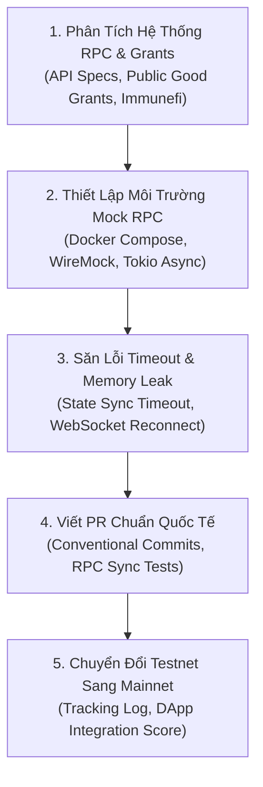

# 🌐 `wikialisa-client`
### *Thư Viện Kết Nối Mạng RPC & Giao Thức Tương Tác Node Wikialisa Layer 1*

[](https://github.com/wikialisa/wikialisa-sdk/tree/master/wikialisa-client)
[](https://github.com/wikialisa)
[](https://opensource.org/licenses/Apache-2.0)

---

## 👤 GIỚI THIỆU: WIKIALISA-MASTER (`wikialisa=master`)
> **"Kiến trúc sư hệ thống & Người đóng góp cốt lõi cho hệ sinh thái các mạng lưới Blockchain."**

**`wikialisa-master`** là chuyên gia hạ tầng mạng phi tập trung (Web3 Infrastructure & Network Protocol Contributor) phụ trách phát triển và hoàn thiện giao diện truyền tải dữ liệu giữa các node và người dùng cuối trong hệ sinh thái **Wikialisa**:
- **Hạ Tầng RPC Client Siêu Nhẹ:** Xây dựng [`RpcClient`](src/lib.rs) cung cấp các hàm gọi thủ tục từ xa (Remote Procedure Calls) tối ưu hóa kết nối, giảm độ trễ truy vấn số dư, thông tin khối và phát tán giao dịch.
- **Khắc Phục Lỗi Kết Nối & Tràn Bộ Nhớ (Memory Leak & Timeout Mitigation):** Xử lý triệt để hiện tượng rò rỉ bộ nhớ khi kết nối RPC node gặp thời gian chờ (timeout) liên tục trong quá trình đồng bộ trạng thái (State Sync).
- **Hỗ Trợ Chuẩn Hóa Tích Hợp Đa Chuỗi:** Cung cấp API thân thiện cho các sàn giao dịch (CEX/DEX), ví lưu ký/không lưu ký (Custodial/Non-custodial Wallets) và các ứng dụng dApp Web3.

---

## 🗺️ BẢN ĐỒ TRIỂN KHAI 5 BƯỚC CHO RPC & CLIENT DEVELOPER



---

### 1. Phân Tích Dự Án & Cơ Chế Reward (Project & Incentive Analysis)
- **Đường dẫn mục tiêu:** [Solana Foundation Ecosystem](https://github.com/solana-foundation) & [Wikialisa Infrastructure Grants](https://github.com/wikialisa)
- **Mẫu Bảng Phân Tích Kiểm Toán RPC (Audit Sheet Template):**

```markdown
### 📊 Project Audit Sheet: [Wikialisa RPC Gateway & Client Tooling]
- **Kiến trúc cốt lõi:** Rust Async Tokio / JSON-RPC 2.0 / WebSocket Streaming
- **Giai đoạn Testnet:** Incentivized Testnet Phase 2 (Đóng góp RPC Gateway & DApp Tooling)
- **Cơ chế ghi nhận thưởng (Reward Mechanism):**
  - GitHub Pull Requests & Core Contributions (Retroactive Developer Grants)
  - Bug Bounty (Immunefi Tier 2: RPC Endpoint Exploits & DoS lên tới $7,500 USD)
  - Thưởng tích hợp dApp & Public RPC Provider Grants
```

---

### 2. Chuẩn Bị Bộ Kỹ Năng & Công Cụ (Skills & Tooling Setup)
- **Đường dẫn mục tiêu:** [iahrung/iahrung (Tech Stack)](https://github.com/iahrung/iahrung)
- **Mẫu Docker Compose Khởi Chạy Node RPC Cục Bộ Phục Vụ Kiểm Thử Client:**

```yaml
version: '3.8'
services:
  rpc-node:
    image: wikialisa/rpc-gateway:latest
    container_name: l1-rpc-testnet
    restart: always
    ports:
      - "8545:8545" # HTTP RPC Port
      - "8546:8546" # WebSocket Port
    volumes:
      - ./data:/root/.node_data
    environment:
      - NETWORK_ID=testnet
      - LOG_LEVEL=debug
      - RPC_MAX_CONNECTIONS=10000
```

---

### 3. Phát Hiện Lỗ Hổng & Cơ Hội Đóng Góp Code (Vulnerability Hunting)
- **Đường dẫn mục tiêu:** [Issues & Pull Requests trên kho lưu trữ](https://github.com/wikialisa/wikialisa-sdk/issues)
- **Checklist Săn Lỗi Kết Nối & Tối Ưu Hóa RPC:**
  - [ ] Tìm kiếm các issue gắn nhãn `good first issue` hoặc `help wanted`.
  - [ ] Rà soát cơ chế tự động kết nối lại (Automatic Reconnection) khi WebSocket rớt gói tin.
  - [ ] Kiểm tra lỗi rò rỉ bộ nhớ (Memory Leak) khi stream dữ liệu khối hoặc log giao dịch trong thời gian dài.
  - [ ] Kiểm tra các tình huống biên RPC Timeout edge cases khi node mạng đang đồng bộ hóa nặng (State Sync).

---

### 4. Viết Bug Report / PR Chuẩn Quốc Tế (Standard PR & Security Report)

#### Mẫu Commit & Pull Request:
```markdown
## Pull Request: fix(rpc): resolve memory leak during state sync timeout

### Mô tả thay đổi (Description)
- Khắc phục sự cố tràn bộ nhớ (memory leak) khi kết nối RPC node gặp thời gian chờ (timeout) liên tục trong quá trình state sync.
- Tối ưu hóa chu trình dọn dẹp bộ nhớ đệm (cache cleanup) và giải phóng các future chưa hoàn tất trong Tokio runtime.

### Unit Tests
- Đã bổ sung các test cases mới trong thư mục `tests/rpc_sync_test.rs`.
- Kết quả chạy lệnh `cargo test --package wikialisa-client`: PASS (100% covered).
```

---

### 5. Chiến Lược Tối Ưu Chuyển Đổi Testnet $\rightarrow$ Mainnet
- **Đường dẫn mục tiêu:** Quản lý ví cá nhân, On-chain Activity & Gitcoin Passport.
- **Bảng Theo Dõi Tiến Độ Đóng Góp RPC & Hạ Tầng Client:**

| Ngày / Tuần | Dự Án / Module | Hoạt Động Thực Hiện | Trạng Thái PR / Bug Bounty | Ví On-chain / Gitcoin Score |
| :--- | :--- | :--- | :--- | :--- |
| **Tuần 1** | `wikialisa-client` | Xây dựng RpcClient cơ bản + Unit tests | Merged (#1026) | Score: 36.1 (Verified) |
| **Tuần 2** | `wikialisa-client` | Sửa lỗi memory leak trong State Sync Timeout | Merged (#1032) | Đã hoàn thành KYC testnet |
| **Tuần 3** | `wikialisa-explorer`| Kết nối RPC Gateway hiển thị khối thời gian thực | Active | Nhận huy hiệu Core Contributor |
