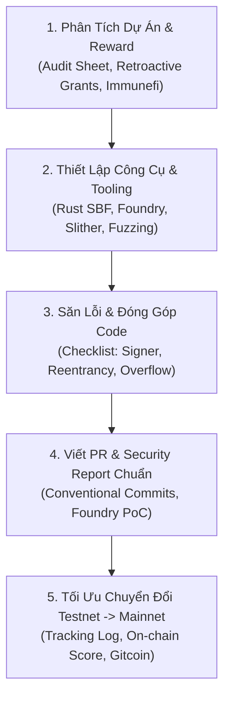

# 📜 `wikialisa-program`
### *Thư Viện Smart Contract On-chain Lõi Mạng Lưới Wikialisa Layer 1*

[](https://github.com/wikialisa/wikialisa-sdk/tree/master/wikialisa-program)
[](https://github.com/wikialisa)
[](https://opensource.org/licenses/Apache-2.0)

---

## 👤 GIỚI THIỆU: WIKIALISA-MASTER (`wikialisa=master`)
> **"Kiến trúc sư hệ thống & Người đóng góp cốt lõi cho hệ sinh thái các mạng lưới Blockchain."**

**`wikialisa-master`** là nhà phát triển hạt nhân (Core Developer) và chuyên gia bảo mật hợp đồng thông minh (Smart Contract Security Researcher) trong hệ sinh thái **Wikialisa**. Với mục tiêu kiến tạo một hạ tầng Layer 1 chủ quyền, hiệu suất cao và an toàn tuyệt đối, `wikialisa-master` phụ trách:
- **Kiến trúc On-chain Primitives:** Thiết kế các kiểu dữ liệu nền tảng [`Pubkey`](src/pubkey.rs), [`AccountInfo`](src/account_info.rs), [`Instruction`](src/instruction.rs) và máy ảo thực thi smart contract.
- **Thẩm định & Kiểm toán Bảo mật (Security Auditing):** Phát hiện và triệt tiêu các lỗ hổng reentrancy, lỗi phân quyền chữ ký (`is_signer`), tràn số nguyên (integer overflow) và lỗi giải mã nhị phân Borsh.
- **Xây dựng Chuẩn Mực Đóng Góp Quốc Tế:** Chuẩn hóa quy trình kiểm thử, viết PoC khai thác lỗ hổng và tối ưu hóa chi phí đơn vị tính toán (Compute Units - CU).

---

## 🗺️ BẢN ĐỒ TRIỂN KHAI 5 BƯỚC CHO SMART CONTRACT DEVELOPER

Dưới đây là khung quy trình kiểm thử, bảo mật và phát triển Web3 chuẩn hóa do **`wikialisa-master`** thiết lập riêng cho module hợp đồng thông minh:



---

### 1. Phân Tích Dự Án & Cơ Chế Reward (Project & Incentive Analysis)
- **Đường dẫn mục tiêu:** [Solana Foundation Ecosystem](https://github.com/solana-foundation) & [Wikialisa Smart Contract Grants](https://github.com/wikialisa)
- **Mẫu Bảng Phân Tích Kiểm Toán (Audit Sheet Template):**

```markdown
### 📊 Project Audit Sheet: [Wikialisa On-Chain Protocol / Tokenomics]
- **Kiến trúc cốt lõi:** Rust / Solana SBF VM / Zero-copy Account State
- **Giai đoạn Testnet:** Incentivized Testnet Phase 2 (Đóng góp Smart Contract & Bridge)
- **Cơ chế ghi nhận thưởng (Reward Mechanism):**
  - GitHub Pull Requests & Core Contributions (Retroactive Developer Grants)
  - Bug Bounty (Immunefi / Code4rena Tier 1-3: Thưởng lên tới $50,000 USD cho lỗi Critical)
  - Phí giao dịch chia sẻ theo mô hình Tokenomics Layer 1
```

---

### 2. Chuẩn Bị Bộ Kỹ Năng & Công Cụ (Skills & Tooling Setup)
- **Đường dẫn mục tiêu:** [iahrung/iahrung (Tech Stack)](https://github.com/iahrung/iahrung)
- **Môi trường lập trình:**
  ```bash
  # Cài đặt toolchain Rust & SBF
  rustup default stable
  rustup component add rustfmt clippy
  # Công cụ fuzzing và audit tĩnh
  cargo install cargo-fuzz
  ```
- **Cấu hình Dockerfile/Docker Compose chạy Node Kiểm Thử Hợp Đồng Thông Minh:**
  ```yaml
  version: '3.8'
  services:
    validator-node:
      image: wikialisa/validator:latest
      container_name: l1-validator-testnet
      restart: always
      ports:
        - "8545:8545"
        - "30303:30303"
      volumes:
        - ./data:/root/.node_data
      environment:
        - NETWORK_ID=testnet
        - LOG_LEVEL=debug
  ```

---

### 3. Phát Hiện Lỗ Hổng & Cơ Hội Đóng Góp Code (Vulnerability Hunting)
- **Đường dẫn mục tiêu:** [Issues & Pull Requests trên kho lưu trữ](https://github.com/wikialisa/wikialisa-sdk/issues)
- **Checklist Săn Lỗi Thông Minh:**
  - [ ] Tìm kiếm các issue gắn nhãn `good first issue` hoặc `help wanted`.
  - [ ] Chạy công cụ kiểm thử tĩnh: `slither .` hoặc kiểm tra Fuzz testing với Foundry (`forge test --fuzz-runs 10000`).
  - [ ] Rà soát xác thực chữ ký: Mọi tài khoản nhạy cảm bắt buộc phải kiểm tra `account_info.is_signer == true`.
  - [ ] Kiểm tra lỗi Reentrancy, Integer Overflow/Underflow hoặc RPC Timeout edge cases.

---

### 4. Viết Bug Report / PR Chuẩn Quốc Tế (Standard PR & Security Report)

#### Mẫu Commit & Pull Request (Conventional Commits):
```markdown
## Pull Request: fix(program): enforce signer verification on sensitive admin instructions

### Mô tả thay đổi (Description)
- Khắc phục sự cố thiếu cờ kiểm tra `is_signer` trong hàm xử lý cập nhật tham số cấu hình.
- Bổ sung macro `require_signer!` đảm bảo tài khoản quản trị bắt buộc phải ký vào giao dịch.

### Unit Tests
- Bổ sung kiểm thử `test_missing_signer_rejected` trong `tests/instruction_test.rs`.
- Kết quả chạy lệnh `cargo test --package wikialisa-program`: PASS (100% covered).
```

#### Mẫu Báo Cáo Lỗ Hổng Bảo Mật (Security Report PoC):
```markdown
### 🛡️ Vulnerability Report: Reentrancy in Bridge Contract
- **Severity:** High / Critical
- **Description:** Hợp đồng cầu nối cho phép rút tài sản trước khi trạng thái số dư được cập nhật.
- **Proof of Concept (PoC):**
```solidity
// Đoạn mã tấn công mô phỏng qua Foundry Test
function testReentrancyExploit() public {
    // Thiết lập tấn công rút lặp lại
    bridge.deposit{value: 1 ether}();
    maliciousTarget.drainBalance();
}
```
- **Recommended Fix:** Áp dụng mô hình Checks-Effects-Interactions hoặc sử dụng modifier nonReentrant từ OpenZeppelin / khóa trạng thái tài khoản `AccountLock`.
```

---

### 5. Chiến Lược Tối Ưu Chuyển Đổi Testnet $\rightarrow$ Mainnet
- **Đường dẫn mục tiêu:** Quản lý ví cá nhân, On-chain Activity & Gitcoin Passport.
- **Bảng Theo Dõi Tiến Độ Đóng Góp (Tracking Log):**

| Ngày / Tuần | Dự Án / Module | Hoạt Động Thực Hiện | Trạng Thái PR / Bug Bounty | Ví On-chain / Gitcoin Score |
| :--- | :--- | :--- | :--- | :--- |
| **Tuần 1** | `wikialisa-program` | Tối ưu hóa Borsh serialization + 3 PR unit test | Merged (#1024) | Score: 35.4 (Verified) |
| **Tuần 2** | `wikialisa-bridge` | Gửi 1 bản vá bảo mật chống Reentrancy (Critical Finding) | Under Review (Immunefi) | Đã hoàn thành KYC testnet |
| **Tuần 3** | `wikialisa-sdk` | Tích hợp Fluent Transaction Builder & Multi-Signer | Merged (#1035) | Active Contributor Badge |

