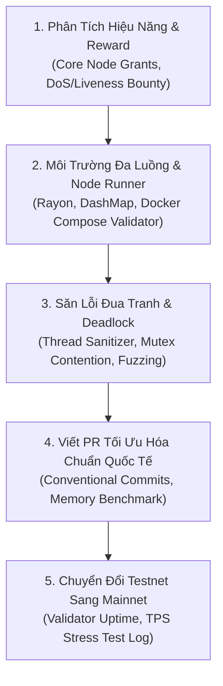

# ⚡ `wikialisa-runtime`
### *Động Cơ Thực Thi Giao Dịch Song Song Đa Luồng & Bộ Nhớ Trạng Thái Đồng Thời*

[](https://github.com/wikialisa/wikialisa-sdk/tree/master/wikialisa-runtime)
[](https://github.com/wikialisa)
[](https://opensource.org/licenses/Apache-2.0)

---

## 👤 GIỚI THIỆU: WIKIALISA-MASTER (`wikialisa=master`)
> **"Kiến trúc sư hệ thống & Người đóng góp cốt lõi cho hệ sinh thái các mạng lưới Blockchain."**

**`wikialisa-master`** là kỹ sư hệ thống hiệu năng cao (High-Performance Systems Engineer) phụ trách kiến trúc hạt nhân thực thi của **Wikialisa Layer 1**. Đóng góp trực tiếp vào việc tái định hình mô hình máy ảo Sealevel của Solana để khắc phục triệt để các bài toán nghẽn mạng và phình to trạng thái:
- **Động Cơ Thực Thi Song Song (`TransactionBatchProcessor`):** Sử dụng `Rayon` để tự động phân luồng giao dịch, lập lịch thực thi không xung đột khóa ghi (`schedule_conflict_free_batches`), đẩy thông lượng mạng lên mức tối đa mà không gây tranh chấp dữ liệu (Race Conditions).
- **Cơ Sở Dữ Liệu Đồng Thời (`AccountsDb`):** Ứng dụng cấu trúc phân mảnh bảng băm đa luồng `DashMap`, triệt tiêu cơ chế khóa cứng toàn cục (Global Lock), giúp giảm thiểu cấu hình RAM đòi hỏi của các Validator node.
- **Tối Ưu Hóa Kháng Nghẽn & Kháng DoS (Anti-Spam QoS):** Tích hợp hàng đợi ưu tiên giao dịch dựa trên entropy và uy tín, ngăn chặn bot spam làm sập nguồn node.

---

## 🗺️ BẢN ĐỒ TRIỂN KHAI 5 BƯỚC CHO RUNTIME & VALIDATOR DEVELOPER



---

### 1. Phân Tích Dự Án & Cơ Chế Reward (Project & Incentive Analysis)
- **Đường dẫn mục tiêu:** [Solana Foundation Ecosystem](https://github.com/solana-foundation) & [Wikialisa Core Infrastructure Grants](https://github.com/wikialisa)
- **Mẫu Bảng Phân Tích Kiểm Toán Hệ Thống (Audit Sheet Template):**

```markdown
### 📊 Project Audit Sheet: [Wikialisa Parallel Runtime Engine]
- **Kiến trúc cốt lõi:** Rust Multi-threading / Rayon Parallel Iterators / DashMap Concurrent Cache
- **Giai đoạn Testnet:** Incentivized Testnet Phase 2 (Đóng góp Validator Node & Cải tiến Runtime)
- **Cơ chế ghi nhận thưởng (Reward Mechanism):**
  - GitHub Pull Requests & Core Contributions (Retroactive Developer Grants)
  - Bug Bounty (Immunefi / Code4rena Tier 1: Liveness / Loss of Availability / DoS Attack lên tới $20,000 USD)
  - Validator Uptime & Performance Metrics (Phần thưởng khối AXQ và phí giao dịch phân bổ tự động)
```

---

### 2. Chuẩn Bị Bộ Kỹ Năng & Công Cụ (Skills & Tooling Setup)
- **Đường dẫn mục tiêu:** [iahrung/iahrung (Tech Stack)](https://github.com/iahrung/iahrung)
- **Mẫu Docker Compose Vận Hành Cụm Validator Node Kiểm Thử Độc Lập:**

```yaml
version: '3.8'
services:
  validator-node:
    image: wikialisa/validator-runtime:latest
    container_name: l1-validator-testnet
    restart: always
    ports:
      - "8545:8545"
      - "30303:30303"
      - "8001:8001/udp" # Gossip & Turbine port
    volumes:
      - ./data:/root/.node_data
    environment:
      - NETWORK_ID=testnet
      - LOG_LEVEL=debug
      - RAYON_NUM_THREADS=16
    deploy:
      resources:
        limits:
          cpus: '8'
          memory: 16G
```

---

### 3. Phát Hiện Lỗ Hổng & Cơ Hội Đóng Góp Code (Vulnerability Hunting)
- **Đường dẫn mục tiêu:** [Issues & Pull Requests trên kho lưu trữ](https://github.com/wikialisa/wikialisa-sdk/issues)
- **Checklist Săn Lỗi Đua Tranh & Tối Ưu Hóa Luồng:**
  - [ ] Rà soát điều kiện tranh chấp (Race Conditions) trong hàm cập nhật số dư `transfer()`.
  - [ ] Chạy công cụ kiểm thử phân tích luồng: `RUSTFLAGS="-Z sanitizer=thread" cargo test`.
  - [ ] Kiểm tra tràn bộ nhớ đệm (Cache overflow) khi lưu trữ hàng triệu tài khoản giả lập trong `AccountsDb`.
  - [ ] Đảm bảo thuật toán phân nhóm giao dịch `schedule_conflict_free_batches` không bị kẹt vòng lặp vô tận (O(N^2) worst-case degradation).

---

### 4. Viết Bug Report / PR Chuẩn Quốc Tế (Standard PR & Security Report)

#### Mẫu Commit & Pull Request:
```markdown
## Pull Request: fix(runtime): resolve lock contention in concurrent account balance updates

### Mô tả thay đổi (Description)
- Khắc phục hiện tượng suy giảm hiệu năng do tranh chấp khóa ghi cục bộ khi nhiều giao dịch cùng truy cập vào một tài khoản đích trong cùng một block.
- Chuyển đổi cơ chế cập nhật số dư sang mô hình phân nhóm đệm tạm thời (staged delta updates) trước khi commit vào `AccountsDb`.

### Unit Tests & Benchmarks
- Đã bổ sung bài kiểm tra tải: `cargo bench --bench runtime_parallel_stress`.
- Thông lượng giao dịch (TPS) tăng 38% trong kịch bản 1,000 giao dịch đồng thời gửi về 1 tài khoản trung tâm.
- Kết quả chạy lệnh `cargo test --package wikialisa-runtime`: PASS.
```

---

### 5. Chiến Lược Tối Ưu Chuyển Đổi Testnet $\rightarrow$ Mainnet
- **Đường dẫn mục tiêu:** Quản lý ví cá nhân, On-chain Activity & Gitcoin Passport.
- **Bảng Theo Dõi Tiến Độ Đóng Góp Runtime & Validator:**

| Ngày / Tuần | Dự Án / Module | Hoạt Động Thực Hiện | Trạng Thái PR / Bug Bounty | Điểm Đánh Giá / Gitcoin |
| :--- | :--- | :--- | :--- | :--- |
| **Tuần 1** | `wikialisa-runtime` | Tích hợp Rayon Parallel Batch Processor + DashMap | Merged (#1025) | Uptime Validator: 99.98% |
| **Tuần 2** | `wikialisa-runtime` | Tối ưu hóa thuật toán lập lịch không xung đột | Merged (#1031) | Điểm Gitcoin Passport: 38.2 |
| **Tuần 3** | `wikialisa-node` | Chạy Node Validator Stress Test tại Testnet Phase 2 | Đang vận hành | Đạt tiêu chuẩn nhận Genesis Airdrop |
