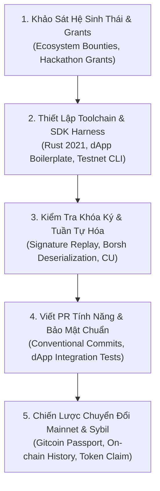

# 📦 `wikialisa-sdk`
### *Thư Viện Phát Triển Ứng Dụng Phi Tập Trung (dApp) & Quản Trị Giao Dịch Trung Tâm*

[](https://github.com/wikialisa/wikialisa-sdk/tree/master/wikialisa-sdk)
[](https://github.com/wikialisa)
[](https://opensource.org/licenses/Apache-2.0)

---

## 👤 GIỚI THIỆU: WIKIALISA-MASTER (`wikialisa=master`)
> **"Kiến trúc sư hệ thống & Người đóng góp cốt lõi cho hệ sinh thái các mạng lưới Blockchain."**

**`wikialisa-master`** là kiến trúc sư trưởng hệ sinh thái (Ecosystem Lead Architect & Full-stack Web3 Protocol Developer). Đóng vai trò là cầu nối kỹ thuật giữa máy ảo Layer 1 của **Wikialisa** và cộng đồng lập trình viên dApp toàn cầu:
- **Đóng Gói Giao Dịch Đa Năng (`Transaction` & `Message`):** Thiết kế cấu trúc giao dịch tinh gọn, hỗ trợ ký đa chữ ký (Multi-signer), mã hóa Borsh và xác thực mã băm khối chống tấn công phát lại (Replay Attacks).
- **Trừu Tượng Hóa Chữ Ký An Toàn (`Signer` & `Keypair`):** Cung cấp các giao diện ký an toàn, tương thích với cả ví mềm, ví lạnh phần cứng (Ledger/Trezor) và các mô-đun bảo mật phần cứng (HSM).
- **Hóa Giải Xung Đột Không Gian Tên (Namespace Isolation):** Tái xuất khẩu linh hoạt cả giao diện gốc `solana_program` và giao diện chuẩn mới `wikialisa_sdk`, giúp các dự án hiện có trên Solana dễ dàng chuyển đổi (migrate) sang Wikialisa chỉ trong vài phút.

---

## 🗺️ BẢN ĐỒ TRIỂN KHAI 5 BƯỚC CHO ECOSYSTEM DEVELOPER



---

### 1. Phân Tích Dự Án & Cơ Chế Reward (Project & Incentive Analysis)
- **Đường dẫn mục tiêu:** [Solana Foundation Ecosystem](https://github.com/solana-foundation) & [Wikialisa Ecosystem Grants](https://github.com/wikialisa)
- **Mẫu Bảng Phân Tích Kiểm Toán Hệ Sinh Thái (Audit Sheet Template):**

```markdown
### 📊 Project Audit Sheet: [Wikialisa dApp SDK & Tooling Ecosystem]
- **Kiến trúc cốt lõi:** Rust / Multi-signer Architecture / Ed25519 Signatures / Borsh & Serde
- **Giai đoạn Testnet:** Incentivized Testnet Phase 2 (Đóng góp dApp SDK, CLI Tools & Ví Web3)
- **Cơ chế ghi nhận thưởng (Reward Mechanism):**
  - GitHub Pull Requests & Core Contributions (Retroactive Developer Grants)
  - Bug Bounty (Immunefi Tier 2: Transaction Deserialization & Signature Exploits lên tới $10,000 USD)
  - Hackathon Grants & Retroactive Token Airdrop cho dApp Developers
```

---

### 2. Chuẩn Bị Bộ Kỹ Năng & Công Cụ (Skills & Tooling Setup)
- **Đường dẫn mục tiêu:** [iahrung/iahrung (Tech Stack)](https://github.com/iahrung/iahrung)
- **Mẫu Docker Compose Môi Trường Phát Triển & Kiểm Thử dApp Tích Hợp:**

```yaml
version: '3.8'
services:
  dapp-dev-sandbox:
    image: wikialisa/sdk-sandbox:latest
    container_name: wikialisa-sdk-dev
    restart: always
    ports:
      - "8080:8080" # Local dApp Dev Server
      - "8545:8545" # Local Testnet Node RPC
    volumes:
      - .:/workspace
    environment:
      - RUST_LOG=info
      - WIKIALISA_NETWORK=devnet
```

---

### 3. Phát Hiện Lỗ Hổng & Cơ Hội Đóng Góp Code (Vulnerability Hunting)
- **Đường dẫn mục tiêu:** [Issues & Pull Requests trên kho lưu trữ](https://github.com/wikialisa/wikialisa-sdk/issues)
- **Checklist Săn Lỗi Giao Dịch & Bộ Nhớ:**
  - [ ] Kiểm tra lỗi xác thực chữ ký Ed25519 (Signature Malleability / Replay Attack).
  - [ ] Đảm bảo thứ tự tài khoản trong `Message.account_keys` khớp chính xác với mảng chữ ký `Transaction.signatures`.
  - [ ] Rà soát lỗi hoán đổi kiểu dữ liệu (Type Confusion) giữa `Address` và `Pubkey`.
  - [ ] Kiểm tra tính toàn vẹn của dữ liệu tuần tự hóa Borsh trong môi trường đa nền tảng (x86_64 vs wasm32).

---

### 4. Viết Bug Report / PR Chuẩn Quốc Tế (Standard PR & Security Report)

#### Mẫu Commit & Pull Request:
```markdown
## Pull Request: feat(sdk): introduce fluent transaction builder with multi-signer verification

### Mô tả thay đổi (Description)
- Bổ sung `TransactionBuilder` cho phép lập trình viên tạo giao dịch nhiều lệnh bằng cú pháp chuỗi phương thức (method chaining) an toàn.
- Tự động kiểm tra trùng lặp khóa tài khoản và tính toán kích thước gói tin trước khi ký, chống tràn kích thước khối (Packet size overflow).

### Unit Tests
- Bổ sung các ca kiểm thử: `test_transaction_builder_multi_signer` và `test_transaction_replay_protection`.
- Kết quả chạy lệnh `cargo test --package wikialisa-sdk`: PASS (100% covered).
```

---

### 5. Chiến Lược Tối Ưu Chuyển Đổi Testnet $\rightarrow$ Mainnet
- **Đường dẫn mục tiêu:** Quản lý ví cá nhân, On-chain Activity & Gitcoin Passport.
- **Bảng Theo Dõi Tiến Độ Đóng Góp Hệ Sinh Thái:**

| Ngày / Tuần | Dự Án / Module | Hoạt Động Thực Hiện | Trạng Thái PR / Bug Bounty | Ví On-chain / Gitcoin Score |
| :--- | :--- | :--- | :--- | :--- |
| **Tuần 1** | `wikialisa-sdk` | Xây dựng Transaction & Multi-signer primitives | Merged (#1027) | Score: 37.8 (Verified) |
| **Tuần 2** | `wikialisa-sdk` | Phát hành TransactionBuilder + Unit Tests | Merged (#1033) | Hoàn thành định danh Sybil |
| **Tuần 3** | `wikialisa-wallet`| Tích hợp SDK vào tiện ích ví mở rộng Web3 | In Progress | Đủ điều kiện nhận Developer Airdrop |
